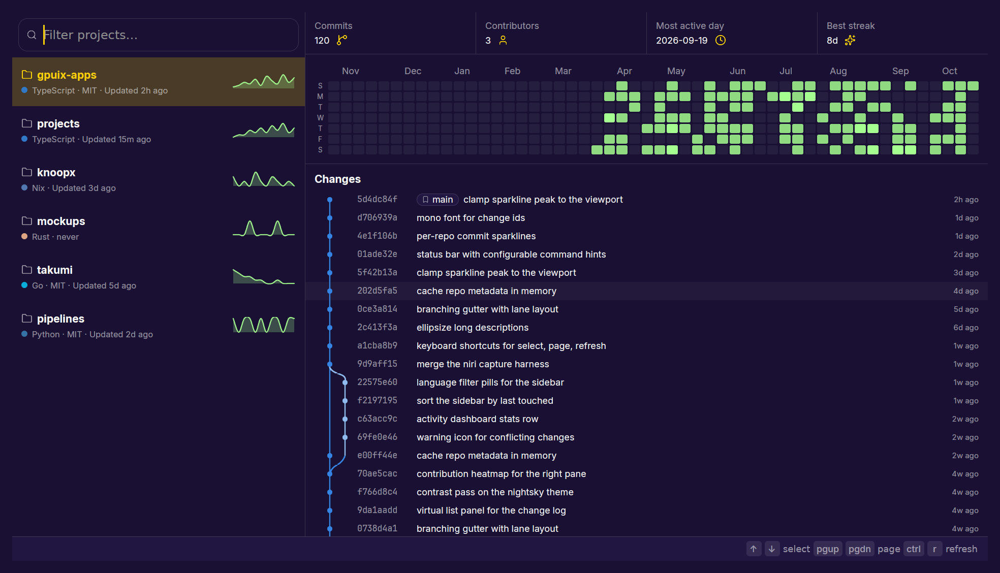

# Projects

A native, GPU-rendered desktop app that scans a configurable set of
directories (default `~/Projects`) for [jujutsu](https://github.com/martinvonz/jj)
repositories and shows them in a split view — no Electron, no webview: the
UI is rendered directly by a GPU renderer (guipx).

## What it does

- **Left sidebar** — a virtualized list of the jj repos under the
  configured roots, sorted by last touched; each row shows the repo name, a
  language dot, "Language · License · Updated Xh ago" (or "never"), and a
  12-week commit sparkline. A filter input at the top filters by
  name/path and supports multi-select language pills (typing suggests
  languages).
- **Right pane** — an activity dashboard (commit count, contributors,
  most active day, best streak, and a contribution heatmap) above the
  changes feed, with a branching gutter (lanes per row), per-row change
  id, bookmark pills, description, conflict markers, and a humanized
  timestamp.

The right pane refreshes automatically when the selected repo's op-head
changes on disk (polling).

## Screenshots



## Configuration

The app reads `config.json`, looked up in the current directory first,
then `~/.config/projects/config.json`.

| Field  | Description                                                                          |
| ------ | ------------------------------------------------------------------------------------ |
| `roots` | Directories to scan for jj repos; default `["~/Projects"]` (`~` expands to your home dir) |

## Commands

User-defined project commands are configured in `config.json`. Any
command that is not configured is unavailable. Each entry in
`commands`:

| Field  | Description                                                              |
| ------ | ------------------------------------------------------------------------ |
| `id`   | Command id; shown in the status bar hints                                |
| `keys` | Key bindings (single key, or a chord like `["ctrl", "shift", "x"]`)       |
| `cmd`  | Executable to run (optional)                                             |
| `args` | Arguments; `{path}` is substituted with the selected project path (optional) |
| `quit` | Optional; when true the app closes after the command runs               |

A configured command takes precedence over the built-in keybindings. See
[`examples/config.json`](examples/config.json).

## Requirements

- [Bun](https://bun.sh)
- `jj` on your `PATH`

## Run

```sh
bun install
bun --hot src/main.tsx
```

or the standalone binary:

```sh
bun run build
dist/projects
```
